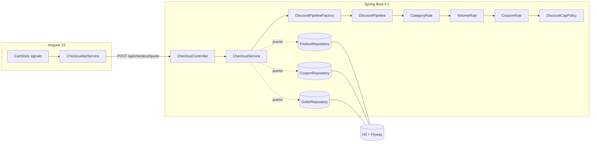

# Arquitectura

> **Borrador (spec 000).** Se completa y cierra en la spec 006 con lo realmente implementado. Decisiones y alternativas: [decisiones.md](decisiones.md).

## 1. Stack y por qué
| Capa | Elección | Motivo |
|---|---|---|
| Backend | Java 25 + Spring Boot 4.1.1, Maven | Tipado fuerte, ecosistema maduro, `BigDecimal` para dinero; Boot 4.1 soporta Java 25 |
| Persistencia | H2 en memoria + JPA + Flyway | Cero instalación, transacciones y `@Version`; DEC-003 |
| Frontend | Angular 22 (standalone, signals, zoneless), Jest | Tipado estricto, estado reactivo con signals; el equipo ya usa Jest |
| Auth | Spring Security + Nimbus (JWT) | Sin dependencias extra (no JJWT); refresh rotado |

## 2. Estructura
Monolito modular con capas ligeras tipo hexagonal (`api → application → domain ← infrastructure`). Módulos: `auth`, `catalog`, `checkout`, `shared`.

## 3. Aislamiento de las reglas matemáticas
El motor vive en `checkout/domain/discount` y **no importa Spring, JPA ni HTTP** (verificado por `DiscountDomainArchitectureTest`, que escanea los `import` del paquete). Recibe un `Cart` y un `Optional<AppliedCoupon>` y devuelve un `DiscountBreakdown` inmutable. Controllers y repositorios quedan fuera; se prueba con JUnit puro.

- **Cascada**: cada regla recibe el total corriente y descuenta sobre él (nunca se suman porcentajes). El orden es fijo: categoría → volumen → cupón.
- **Redondeo**: solo `Money` usa `RoundingMode`; cada paso redondea a escala 2 con `HALF_UP` (DEC-007/DEC-021).
- **Tope**: `DiscountCapPolicy` es la única clase que conoce el 35 %; si el acumulado lo supera, añade un paso `CAP_ADJUSTMENT` con el exceso en **negativo**, de modo que la suma de pasos cuadra con `totalDiscount`.
- **Config tipada**: `DiscountProperties` (dominio) se enlaza desde `app.discounts.*` mediante `DiscountSettings` + `DiscountConfig` en infraestructura, así el dominio no depende de Spring (DEC-020).
- **Transacción de compra**: `CheckoutService` (sin `@Transactional`) orquesta un reintento acotado; cada intento es una transacción nueva en `CheckoutTransaction.place(...)`, que recalcula, descuenta el stock de todas las líneas (con `saveAndFlush` para detectar el conflicto de `@Version` dentro de la transacción) y persiste la orden con su desglose (DEC-023/DEC-025). `quote` y `orders` comparten `CheckoutCalculation`, así que la cotización y la compra nunca divergen (DEC-006).
- **Estado del checkout (front)**: `CheckoutStore` (signals) re-cotiza con un `effect` sobre el carrito y **descarta por secuencia** las respuestas que llegan tarde (DEC-027); el cupón solo se confirma si el backend lo acepta y el 409 se distingue con un flag para refrescar el catálogo (DEC-028). Los componentes de desglose/banner son "tontos" (solo pintan `inputs`): no hay lógica de negocio en la vista.

## 4. Patrones (≥ 2 implementados en código)
| Patrón | Dónde | Por qué |
|---|---|---|
| **Strategy** | `DiscountRule` (`CategoryDiscountRule`, `VolumeDiscountRule`, `CouponDiscountRule`) | Añadir una regla no toca las existentes (OCP) |
| **Pipeline / Chain** | `DiscountPipeline` | Hace explícita la precedencia; cada paso recibe el total corriente |
| **Factory** | `DiscountPipelineFactory` | Arma el pipeline por request; el cupón solo entra si existe |
| **Port / Adapter** | `*Repository` en domain, JPA en infrastructure | Dominio independiente de la BD (DIP) |
| **Observer** | `CartStore` con signals (front) | Vistas reactivas sin suscripciones manuales |
| **Store + secuencia (front)** | `CheckoutStore` (`effect` + contador de secuencia) | Descarta respuestas obsoletas de un POST no idempotente (DEC-027) |

## 5. Trade-offs (completar en spec 006)
- Backend como única fuente de cálculo (DEC-006): sin duplicar lógica, a costa de una llamada por cotización.
- H2 en memoria (DEC-003): simplicidad y velocidad de entrega frente a persistencia real.
- Optimistic locking (DEC-004): sin bloqueos largos, con reintentos bajo contención.
- Auth completo (DEC-010): más seguridad y trazabilidad, más tiempo de construcción.
- Sin WebSocket (DEC-005): menos complejidad; sin stock en vivo entre usuarios.

## 6. Pendiente de la spec 006
Diagrama final, tabla de trade-offs con lo implementado, evidencia de cobertura y guion de la demo.
