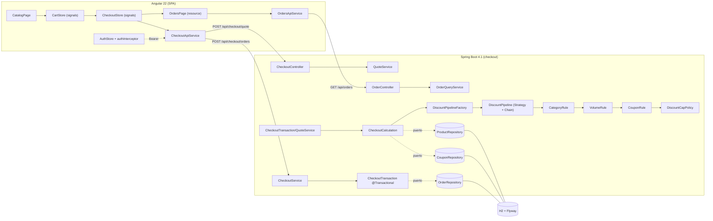

# Arquitectura

> Documento **final** (cerrado en la spec 006) con lo realmente implementado. Decisiones y alternativas: [decisiones.md](decisiones.md). Requisitos: [requirements.md](requirements.md).

## 1. Stack y por qué
| Capa | Elección | Motivo |
|---|---|---|
| Backend | Java 25 + Spring Boot 4.1.1, Maven (wrapper) | Tipado fuerte, `BigDecimal` para dinero y sentido de la responsabilidad en la frontera; Boot 4.1 soporta Java 25 |
| Persistencia | H2 en memoria + JPA + Flyway | Cero instalación, `@Version` para stock y migraciones versionadas; [DEC-003](decisiones.md) |
| Frontend | Angular 22 (standalone, signals, zoneless), Jest | Tipado estricto, estado reactivo con signals; el equipo ya usa Jest |
| Auth | Spring Security + Nimbus (JWT) | Sin dependencias extra (no JJWT), refresh rotado; [DEC-010](decisiones.md) |
| Verificación | JUnit 5 + Mockito + JaCoCo 0.8.15 · Jest 30 | Umbral del 80 % en ambos lados; el build falla si baja |

## 2. Estructura
Monolito modular con capas ligeras tipo hexagonal. Módulos por dominio (`auth`, `catalog`, `checkout`) más un módulo `shared` transversal:

```
apps/backend/src/main/java/com/ecommerce/
  auth/       catalog/       checkout/       shared/{error,security}
  ├ api/            ← controllers + DTOs (records) + mappers
  ├ application/    ← casos de uso (servicios) · orquestación
  ├ domain/         ← entidades, reglas, **puertos** (interfaces) · sin Spring/JPA/HTTP
  └ infrastructure/ ← adaptadores JPA, hashers, proveedores, configuración
```

La dirección de dependencias es `api → application → domain ← infrastructure`: el dominio define **puertos** (p. ej. `checkout/domain/port/OrderRepository`) y la infraestructura los implementa (`checkout/infrastructure/JpaOrderRepositoryAdapter`). `api` y `application` no conocen JPA.



> `QuoteService` y `CheckoutTransaction` comparten `CheckoutCalculation`, así que la cotización (pública) y la compra (autenticada) **no pueden divergir** ([DEC-006](decisiones.md)).

## 3. Aislamiento del cálculo y de los controllers

### 3.1 El motor de descuentos es dominio puro
Vive en `checkout/domain/discount` y **no importa Spring, JPA ni HTTP**. Lo garantiza un test de arquitectura: `DiscountDomainArchitectureTest` recorre los `import` del paquete y falla si aparece cualquier dependencia de framework. El motor recibe un `Cart` y un `Optional<AppliedCoupon>` y devuelve un `DiscountBreakdown` inmutable; se prueba con JUnit puro (sin contexto de Spring).

- **Cascada, no suma de porcentajes**: cada regla recibe el *total corriente* y descuenta sobre él. Orden fijo: categoría → volumen → cupón.
- **Redondeo explícito**: solo `Money` usa `RoundingMode`; cada paso redondea a escala 2 con `HALF_UP`, de modo que la suma de las líneas del desglose es exacta ([DEC-007](decisiones.md)/[DEC-021](decisiones.md)).
- **Tope en una sola clase**: `DiscountCapPolicy` es la única que conoce el 35 %. Si el acumulado lo supera, añade un paso `CAP_ADJUSTMENT` con el exceso en **negativo**: la suma de pasos cuadra siempre con `totalDiscount` y `capApplied = true`.
- **Config tipada sin Spring en el dominio**: `DiscountProperties` (dominio) se enlaza desde `app.discounts.*` con `DiscountConfig` (`checkout/infrastructure/config`) ([DEC-020](decisiones.md)).

### 3.2 Controllers finos
`AuthController`, `ProductController`, `CheckoutController` y `OrderController` solo validan la entrada (`@Valid`), delegan en un caso de uso y mapean a DTOs (`record`). No hay lógica de negocio en la capa `api`. Los errores salen siempre como `ProblemDetail` (RFC 9457) con una propiedad `code` estable, resueltos en `shared/error/GlobalExceptionHandler` (sin filtrar stack traces).

### 3.3 Compra transaccional y stock
`CheckoutService` **no** es `@Transactional`: orquesta un reintento acotado (3 intentos) y cada intento es una transacción nueva en `CheckoutTransaction.place(...)`. Esta recalcula, descuenta el stock de todas las líneas (con `saveAndFlush` para que el conflicto de `@Version` salte *dentro* de la transacción) y persiste la orden con su desglose. Si algo falla, la transacción revierte entera: nunca queda stock descontado sin orden ([DEC-023](decisiones.md)/[DEC-025](decisiones.md)).

### 3.4 Estado del checkout en el front
`CheckoutStore` (signals) re-cotiza con un `effect` sobre el carrito y **descarta por contador de secuencia** las respuestas que llegan tarde (el `POST` no es idempotente); el cupón solo se confirma si el backend lo acepta, y el 409 se distingue con un flag para refrescar el catálogo ([DEC-027](decisiones.md)/[DEC-028](decisiones.md)). Los componentes de desglose y banner son "tontos": solo pintan `inputs`, sin lógica de negocio en la vista.

## 4. Patrones implementados (ubicados en el código)
| Patrón | Dónde (ruta real) | Por qué |
|---|---|---|
| **Strategy** | `checkout/domain/discount/DiscountRule` + `CategoryDiscountRule`, `VolumeDiscountRule`, `CouponDiscountRule` | Añadir una regla no toca las existentes (OCP); la interfaz es funcional |
| **Pipeline / Chain** | `checkout/domain/discount/DiscountPipeline` | Hace explícita la precedencia; cada paso recibe el total corriente |
| **Factory** | `checkout/domain/discount/DiscountPipelineFactory` | Arma el pipeline por petición; la regla de cupón solo entra si hay cupón |
| **Port / Adapter** | puertos en `*/domain/port/*`, adaptadores en `*/infrastructure/Jpa*Adapter` | Dominio independiente de la BD (DIP); el `Page` de Spring Data se traduce a `PageResult<T>` de dominio |
| **Observer** | `features/cart/cart.store.ts` (`CartStore` con signals/`computed`) | Vistas reactivas sin suscripciones manuales |
| **Store + secuencia (front)** | `features/checkout/checkout.store.ts` (`effect` + contador) | Descarta respuestas obsoletas de un POST no idempotente ([DEC-027](decisiones.md)) |

Evidencia del aislamiento: `DiscountDomainArchitectureTest` (backend) y la ausencia de `any`/casts inseguros en el front (`@typescript-eslint/no-explicit-any` en `eslint.config.js`).

## 5. Trade-offs asumidos
| Decisión | A favor | A costa de | Ref |
|---|---|---|---|
| Backend como **única fuente de cálculo** | Cero duplicación del motor; el cliente no puede falsear totales | Una llamada HTTP por cotización | DEC-006 |
| **H2 en memoria** + Flyway | Cero instalación; seed reproducible en tests y demo | Sin persistencia real entre reinicios | DEC-003 |
| **Optimistic locking** (`@Version`) + reintento | Sin bloqueos largos; buen rendimiento en lectura | Reintento bajo contención | DEC-004 |
| **Auth completo** (access/refresh rotado, roles) | Seguridad y trazabilidad; cumple RF-A1/A2 | Más tiempo de construcción | DEC-010 |
| **Sin WebSocket** | Menos complejidad | Sin stock en vivo entre pestañas/usuarios | DEC-005 |
| **`quote` público** | Permite el desglose antes de iniciar sesión (HU 2) | Superficie de cálculo expuesta (sin efectos) | — |
| **Cupones solo validados desde BD** | Stock de cupones real sin CRUD | Sin UI de administración (fuera de alcance) | DEC-002 |

## 6. Evidencia de cobertura (spec 006)
| Suite | Comando | Tests | Cobertura |
|---|---|---|---|
| Backend | `cd apps/backend && ./mvnw verify` | **293** (0 fallos) | LINE **99.79 %** (971/973) · BRANCH **100.00 %** (180/180) |
| Frontend | `cd apps/frontend && npm run test:coverage` | **143** | **100 %** en statements / branches / functions / lines |

> En **Windows/PowerShell** los mismos comandos son `cd apps\backend; .\mvnw.cmd verify` y `cd apps\frontend; npm run test:coverage` (ver [README](../README.md)).

Único hueco (justificado): el `catch (NoSuchAlgorithmException)` de `SecureRandomRefreshTokenProvider.hash` (2 líneas) es inalcanzable porque SHA-256 está garantizado por el JVM. El umbral del build es ≥ 80 % ([DEC-011](decisiones.md)). Reporte JaCoCo: `apps/backend/target/site/jacoco/index.html`.
